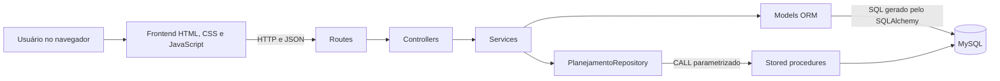
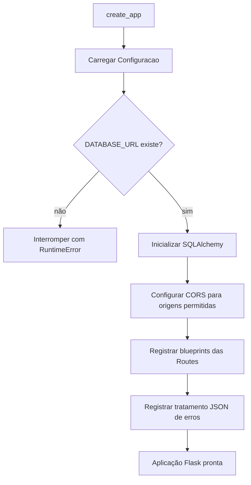
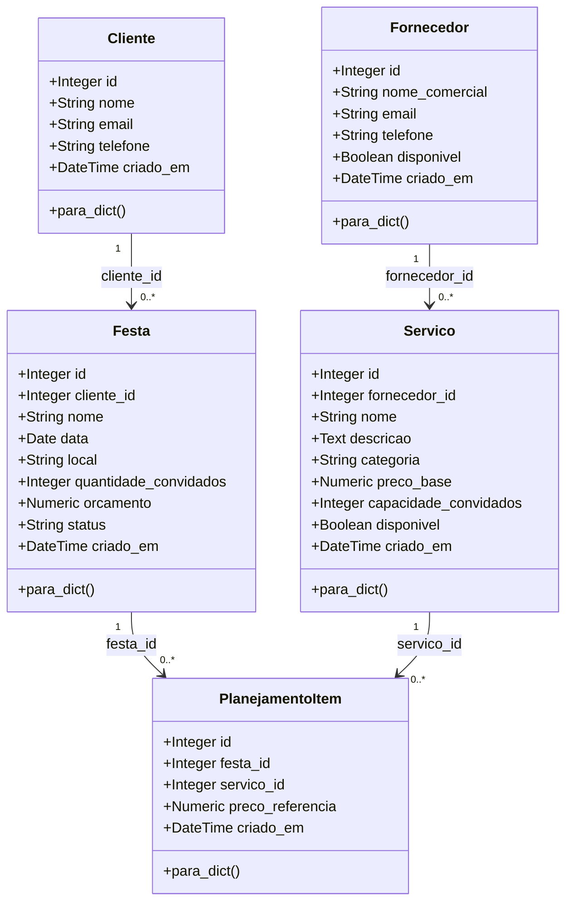
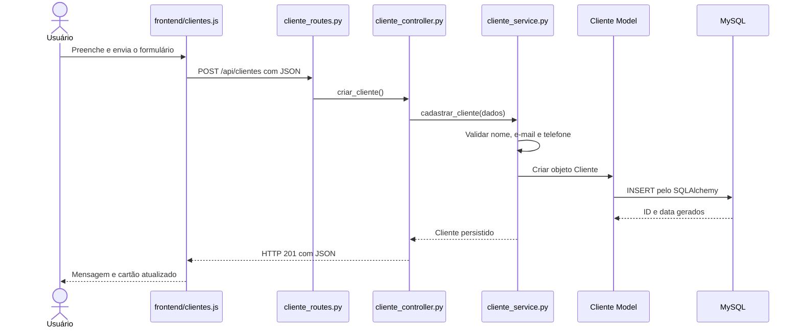
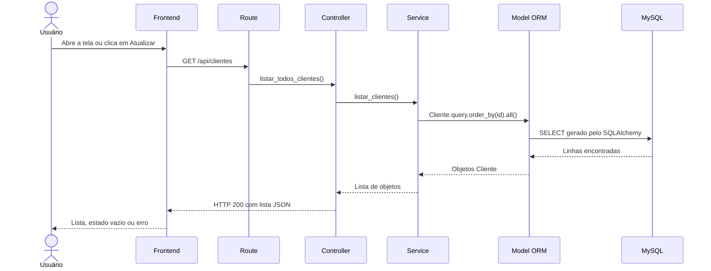
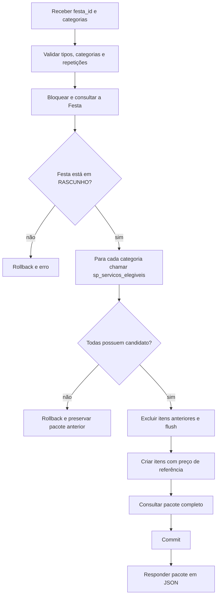
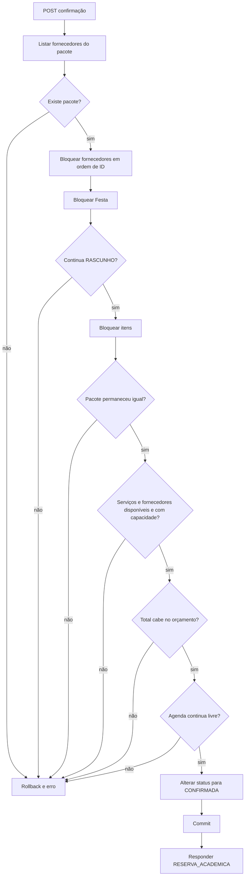

# Arquitetura do FestKids

## 1. Visão geral

O FestKids é um monólito modular: existe um único backend Flask, mas o código é separado por responsabilidade. O frontend é estático e conversa com a API exclusivamente por HTTP e JSON.

A direção é sempre da entrada para a persistência. O banco não conhece o frontend, o Controller não acessa o banco e o Repository não decide regras de negócio.

## 2. Responsabilidade de cada parte

| Parte | Local | Responsabilidade | Não deve fazer |
|---|---|---|---|
| Frontend | `frontend/` | Exibir telas, coletar dados e chamar a API | Calcular regra de negócio ou acessar MySQL |
| Route | `backend/routes/` | Associar método e URL ao Controller | Validar domínio ou consultar banco |
| Controller | `backend/controllers/` | Ler entrada HTTP e montar resposta HTTP | Usar `db`, Model ou SQL diretamente |
| Service | `backend/services/` | Validar dados, aplicar regras e controlar transações | Formatar página ou definir URL |
| Model | `backend/models/` | Mapear classe Python para tabela e serializar entidade | Concentrar os casos de uso do planejamento |
| Repository | `backend/repositories/` | Executar consultas e bloqueios especializados | Executar `commit` ou decidir se pode confirmar |
| Stored procedure | `backend/database/create_database.sql` | Manter SQL especializado estudado no banco | Receber texto SQL concatenado pelo usuário |

## 3. Inicialização da aplicação

`backend/__init__.py` contém a factory `create_app`. Ela executa esta sequência:

`backend/run.py` cria a aplicação e usa `FLASK_HOST`, `FLASK_PORT` e `FLASK_DEBUG`. A configuração real fica em `backend/.env.local`, que não é versionado.

## 4. Diagrama de classes do domínio

O diagrama representa as cinco Models existentes. Os relacionamentos são implementados com chaves estrangeiras; o código não depende de atributos `relationship` nem de `Mapped`.

### Por que existe PlanejamentoItem

`PlanejamentoItem` transforma a relação entre Festa e Serviço em uma entidade própria. Além dos dois IDs, ela guarda `preco_referencia`. Assim, se o preço-base do Serviço mudar depois, o pacote já montado não muda silenciosamente.

A combinação `festa_id + servico_id` é única.

## 5. Fluxo de entrada: cadastrar um recurso

O cadastro de Cliente é o exemplo mais simples; Fornecedor, Serviço e Festa seguem o mesmo caminho.

Se a validação falhar, o Service lança `ErroValidacao`; o tratamento global devolve código `400` no formato JSON padronizado. Se o e-mail já existir, a resposta é `409`.

## 6. Fluxo de recuperação: listar registros

Consultar um único ID usa o mesmo fluxo com `filter_by(id=...).first()`. Quando não existe registro, o Service lança `RecursoNaoEncontrado` e a API devolve `404` sem traceback.

## 7. Fluxo especializado: sugerir pacote

A procedure ordena os candidatos por `preco_base` e depois por `id`. Por isso, a sugestão é determinística e explicável.

## 8. Fluxo transacional: confirmar planejamento

Todos os bloqueios, consultas e a alteração acontecem na mesma sessão do SQLAlchemy. O Repository não executa `commit`; o Service confirma tudo ao final ou executa `rollback` diante de qualquer exceção.

## 9. ORM e Repository não são concorrentes

- CRUD simples: `Model.query`, `db.session.add`, `delete` e `commit` nos Services.
- Consulta especializada: procedure MySQL chamada pelo `PlanejamentoRepository`.
- Regra de negócio: sempre no Service.
- Transação: controlada pelo Service, inclusive quando há chamadas ao Repository.

Resposta curta para a banca:

> O ORM resolve as operações simples sobre uma entidade. O Repository foi reservado para consultas e bloqueios especializados do planejamento; ele chama procedures com parâmetros e participa da transação aberta pelo Service.

## 10. Tratamento de erros

`backend/error_handlers.py` converte exceções em respostas previsíveis:

| Situação | Exceção | HTTP |
|---|---|---:|
| Entrada inválida | `ErroValidacao` | 400 |
| Registro inexistente | `RecursoNaoEncontrado` | 404 |
| Integridade ou estado incompatível | `ErroConflito` | 409 |
| Corpo acima do limite | `RequestEntityTooLarge` | 413 |
| Falha inesperada | `Exception` | 500 |

Falhas internas são registradas no terminal do backend, mas o JSON enviado ao navegador contém apenas uma mensagem genérica.

## 11. Evidências no código

- Factory e extensões: `backend/__init__.py` e `backend/extensions.py`.
- Routes: `backend/routes/`.
- Controllers sem acesso ao banco: `backend/controllers/`.
- Regras e transações: `backend/services/`.
- Mapeamento clássico com `db.Column`: `backend/models/`.
- Procedures e `ENGINE = InnoDB`: `backend/database/create_database.sql`.
- Chamadas `CALL` parametrizadas: `backend/repositories/planejamento_repository.py`.
- Integração HTTP: `frontend/js/api.js` e `frontend/js/planejamento.js`.
- Testes: `backend/tests/`.
