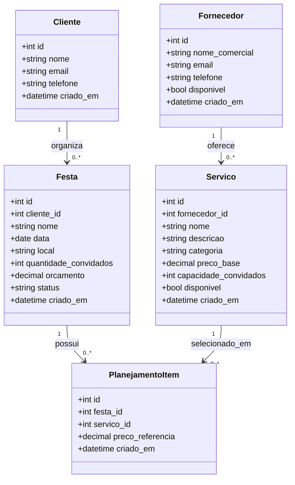

# Modelo de domínio do FestKids

## 1. Objetivo

Este documento transforma os requisitos do FestKids em entidades, atributos, relacionamentos e regras estruturais. Ele é a referência para o futuro diagrama físico do MySQL e para as Models do SQLAlchemy.

O modelo inicial contém cinco entidades:

1. Cliente
2. Fornecedor
3. Serviço
4. Festa
5. Item de Planejamento

Não existem entidades de usuário, senha, pagamento, proposta ou avaliação nesta versão.

## 2. Conceitos utilizados

### Identificador

Cada entidade possui um `id`, número único criado pelo banco. Ele será a chave primária, também chamada de **PK** (*Primary Key*).

### Chave estrangeira

Uma chave estrangeira, ou **FK** (*Foreign Key*), guarda o identificador de outra entidade e representa um relacionamento.

Exemplo: `Festa.cliente_id` indica qual Cliente é responsável pela Festa.

### Cardinalidade

Cardinalidade informa quantas instâncias podem participar de um relacionamento:

- `1` significa exatamente uma;
- `0..*` significa nenhuma ou várias;
- `1..*` significa uma ou várias.

## 3. Entidades e atributos

### 3.1 Cliente

Representa a pessoa responsável por organizar uma ou mais festas.

| Atributo | Tipo conceitual | Obrigatório | Regra |
|---|---|---:|---|
| `id` | inteiro positivo | sim | Identificador único gerado pelo banco |
| `nome` | texto de até 120 caracteres | sim | Não pode ser vazio |
| `email` | texto de até 255 caracteres | sim | Deve possuir formato válido e ser único |
| `telefone` | texto de até 20 caracteres | sim | Armazena o telefone como texto, sem cálculo numérico |
| `criado_em` | data e hora | sim | Preenchido no cadastro |

O telefone é texto porque pode conter código do país, DDD, espaços, parênteses e hífen.

### 3.2 Fornecedor

Representa uma empresa ou profissional que oferece serviços para festas infantis.

| Atributo | Tipo conceitual | Obrigatório | Regra |
|---|---|---:|---|
| `id` | inteiro positivo | sim | Identificador único gerado pelo banco |
| `nome_comercial` | texto de até 120 caracteres | sim | Não pode ser vazio |
| `email` | texto de até 255 caracteres | sim | Deve possuir formato válido e ser único |
| `telefone` | texto de até 20 caracteres | sim | Contato do fornecedor |
| `disponivel` | verdadeiro ou falso | sim | Indica se o fornecedor aceita novas seleções em geral |
| `criado_em` | data e hora | sim | Preenchido no cadastro |

O campo `disponivel` não confirma uma data específica. Ele apenas permite desativar temporariamente o fornecedor. Conflitos de uma data serão calculados usando festas confirmadas.

### 3.3 Serviço

Representa uma opção comercial oferecida por um fornecedor.

| Atributo | Tipo conceitual | Obrigatório | Regra |
|---|---|---:|---|
| `id` | inteiro positivo | sim | Identificador único gerado pelo banco |
| `fornecedor_id` | inteiro positivo | sim | FK para Fornecedor |
| `nome` | texto de até 120 caracteres | sim | Não pode ser vazio |
| `descricao` | texto | não | Detalhes adicionais do serviço |
| `categoria` | texto controlado de até 40 caracteres | sim | Deve pertencer à lista de categorias válidas |
| `preco_base` | decimal com duas casas | sim | Deve ser maior ou igual a zero |
| `capacidade_convidados` | inteiro positivo | sim | Quantidade máxima atendida |
| `disponivel` | verdadeiro ou falso | sim | Indica se o serviço pode participar de novas sugestões |
| `criado_em` | data e hora | sim | Preenchido no cadastro |

Categorias iniciais:

- buffet;
- decoração;
- fotografia;
- recreação;
- bolo e doces;
- espaço.

A categoria pertence ao Serviço, pois um mesmo fornecedor poderá oferecer serviços de categorias diferentes.

### 3.4 Festa

Representa o evento que será planejado.

| Atributo | Tipo conceitual | Obrigatório | Regra |
|---|---|---:|---|
| `id` | inteiro positivo | sim | Identificador único gerado pelo banco |
| `cliente_id` | inteiro positivo | sim | FK para Cliente |
| `nome` | texto de até 120 caracteres | sim | Identificação amigável da festa |
| `data` | data | sim | Dia do evento |
| `local` | texto de até 180 caracteres | sim | Local informado para a demonstração |
| `quantidade_convidados` | inteiro positivo | sim | Deve ser maior que zero |
| `orcamento` | decimal com duas casas | sim | Deve ser maior que zero |
| `status` | texto controlado | sim | `RASCUNHO` ou `CONFIRMADA` |
| `criado_em` | data e hora | sim | Preenchido no cadastro |

Toda festa começa como `RASCUNHO`. Somente o caso de uso Confirmar Planejamento poderá alterar seu status para `CONFIRMADA`.

### 3.5 Item de Planejamento

Representa a escolha de um Serviço para uma Festa.

| Atributo | Tipo conceitual | Obrigatório | Regra |
|---|---|---:|---|
| `id` | inteiro positivo | sim | Identificador único gerado pelo banco |
| `festa_id` | inteiro positivo | sim | FK para Festa |
| `servico_id` | inteiro positivo | sim | FK para Serviço |
| `preco_referencia` | decimal com duas casas | sim | Cópia do preço-base no momento da seleção |
| `criado_em` | data e hora | sim | Preenchido na inclusão |

A combinação de `festa_id` e `servico_id` deverá ser única. O mesmo serviço não poderá aparecer duas vezes no mesmo planejamento.

O `preco_referencia` é preservado porque o preço-base do Serviço poderá mudar depois. Sem essa cópia, um planejamento antigo mudaria de valor silenciosamente.

## 4. Relacionamentos

### Cliente e Festa

- Um Cliente poderá possuir nenhuma ou várias Festas.
- Cada Festa deverá pertencer a exatamente um Cliente.

```text
Cliente 1 ───── 0..* Festa
```

### Fornecedor e Serviço

- Um Fornecedor poderá oferecer nenhum ou vários Serviços.
- Cada Serviço deverá pertencer a exatamente um Fornecedor.

```text
Fornecedor 1 ───── 0..* Serviço
```

### Festa, Item de Planejamento e Serviço

- Uma Festa poderá possuir nenhum ou vários Itens de Planejamento.
- Cada Item de Planejamento pertencerá a exatamente uma Festa.
- Um Serviço poderá aparecer em nenhum ou vários Itens de Planejamento.
- Cada Item de Planejamento apontará para exatamente um Serviço.

```text
Festa 1 ───── 0..* Item de Planejamento 0..* ───── 1 Serviço
```

Item de Planejamento transforma o relacionamento muitos-para-muitos entre Festa e Serviço em duas relações um-para-muitos e ainda guarda o preço utilizado.

## 5. Diagrama de classes



## 6. Regras estruturais derivadas

1. Não existe Festa sem Cliente.
2. Não existe Serviço sem Fornecedor.
3. Não existe Item de Planejamento sem Festa e Serviço.
4. E-mails de clientes e fornecedores são únicos dentro de suas respectivas entidades.
5. Dinheiro não será representado com ponto flutuante binário.
6. Quantidade de convidados e capacidade devem ser números positivos.
7. Serviço ou Fornecedor indisponível não poderá entrar em nova sugestão.
8. O preço do item não muda quando o preço-base do serviço é atualizado.
9. A disponibilidade em uma data não é um atributo armazenado; ela é resultado de uma consulta às festas confirmadas.
10. O status da Festa não poderá ser confirmado por uma simples edição cadastral.

## 7. Decisões e simplificações

- Não haverá tabela de Categoria nesta primeira versão. As categorias serão uma lista controlada pela aplicação.
- Não haverá endereço estruturado ou geolocalização; `local` será texto para a demonstração.
- Não haverá horários: uma confirmação reserva o fornecedor durante o dia inteiro.
- Não haverá quantidade por Item de Planejamento; cada Serviço será uma escolha única.
- Não haverá exclusão em cascata silenciosa. Vínculos deverão impedir exclusões incoerentes.
- Disponibilidade geral e conflito de agenda são conceitos diferentes.

Essas simplificações reduzem o tamanho do projeto sem remover as regras necessárias para a banca.

